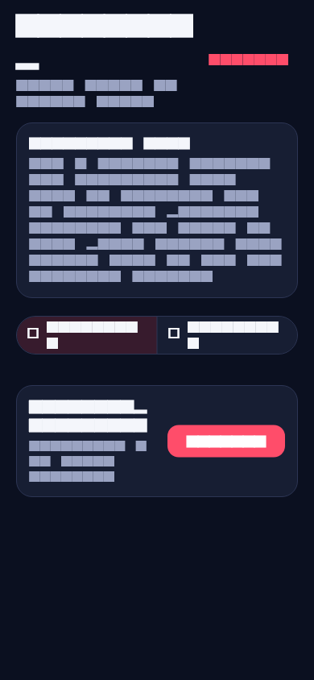
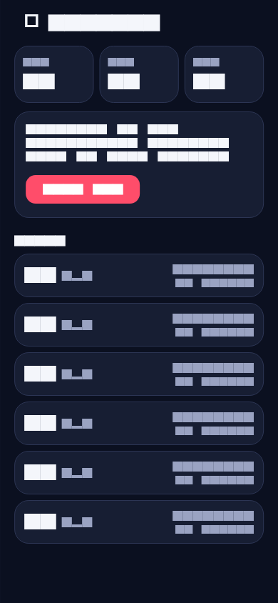
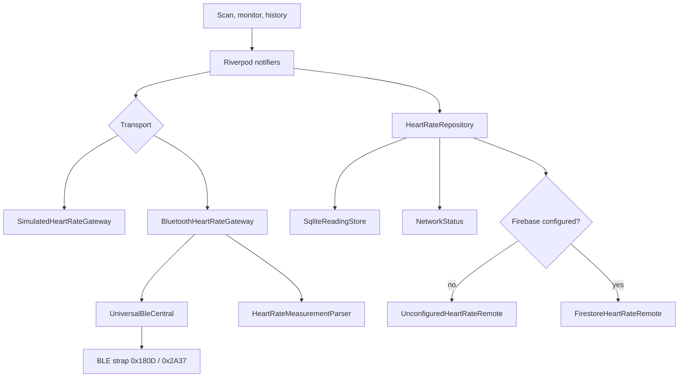

# PulseKeep

A small **portfolio demo** of a Flutter heart-rate monitor. It scans for a Bluetooth Low Energy device that advertises the standard Heart Rate Service (`0x180D`), charts live BPM, stores readings in SQLite, and can sync them to Cloud Firestore when a Firebase project is configured.

This is not a medical device, a training plan, or a product. Zone labels are fixed demo bands. The built-in simulator is a scripted waveform, not a model of physiology. Nothing here should be used to make health decisions.





Screenshots are golden images from the widget test in `tool/capture_screenshots.dart`, captured at a 390×844 phone surface with the simulator and an empty Firebase config.

## Features

- **Simulator by default.** The app starts on "PulseKeep Simulator" so it runs on a desktop, an emulator, or a phone with no strap and no Bluetooth radio.
- **Real BLE path.** Switching to Bluetooth scans for Heart Rate Service `0x180D` and subscribes to Heart Rate Measurement `0x2A37` (notifications, or indications when notify is unsupported). The GATT parser handles 8- and 16-bit BPM, sensor contact, energy expended, and RR-intervals.
- **Live monitor.** BPM, a demo zone chip (resting / easy / moderate / hard / peak), and a one-minute `fl_chart` trace. The simulator can drift between rest, walk, and run.
- **Offline-first log.** Every sample is inserted into SQLite first. A `synced` flag is the upload queue. History shows average, min, and max, grouped by day.
- **Optional Firestore sync.** With no keys, sync stays on-device and says so. With real options, pending rows are written to `heart_rate_readings` in batches and marked synced. Failures stay queued for a later retry.
- **Tested boundaries.** Domain ports (`HeartRateGateway`, `BleCentral`, `ReadingStore`, `HeartRateRemote`, `NetworkStatus`) keep unit and widget tests off the plugins.

## Architecture

Presentation (Riverpod) talks to a repository. The repository owns the local-then-remote order. Transport selection picks the simulator or the Bluetooth gateway; the Bluetooth stack is not constructed until that provider is watched.



| Layer | What lives there |
| --- | --- |
| `lib/domain` | Readings, failures, GATT parser, zone bands, repository, ports |
| `lib/data` | SQLite, Firestore, connectivity, `universal_ble` adapter, simulator |
| `lib/presentation` | Theme, scan / monitor / history, Riverpod providers |
| `lib/bootstrap.dart` | Opens SQLite and builds the remote at startup |

Demo zone cutoffs, used only for the chip color: under 90 resting, under 110 easy, under 140 moderate, under 170 hard, otherwise peak.

## Setup

Flutter **3.47.7** (Dart 3.13) or newer. Android and iOS are the device targets; widget tests and the simulator also run on desktop.

```bash
flutter pub get
flutter run
```

The first screen is the simulator. Tap **PulseKeep Simulator**, then switch Rest / Walk / Run. Readings land in the on-device history immediately.

### A real heart-rate strap

1. Put the strap in pairing/advertising mode. It must expose Heart Rate Service `0x180D`.
2. On the scan screen, switch the segmented control from Simulator to Bluetooth.
3. Allow the Bluetooth permission and tap **Scan for monitors**.

Android (`android/app/src/main/AndroidManifest.xml`):

- `BLUETOOTH_SCAN` with `neverForLocation`, plus `BLUETOOTH_CONNECT`
- Legacy `BLUETOOTH` / `BLUETOOTH_ADMIN` and location permissions capped at older API levels
- `android.hardware.bluetooth_le` is **not** required, so the demo still installs on hardware without a radio

iOS (`ios/Runner/Info.plist`):

- `NSBluetoothAlwaysUsageDescription` explains the heart-rate scan
- `UIBackgroundModes` includes `bluetooth-central` so an active connection can keep delivering measurements
- The app is a central only; it does not advertise

`minSdk` follows Flutter's default, and is at least 21.

### Firebase (optional)

Leave `lib/data/remote/firebase_project_config.dart` empty. Startup never calls `Firebase.initializeApp`, and History shows that readings stay on the device.

To turn sync on, paste a real project into that file (or replace the constants with the output of `flutterfire configure`):

- `apiKey`, `appId`, `messagingSenderId`, `projectId`
- Empty strings and `YOUR_*` placeholders are treated as unconfigured

Pending readings are merge-written to the `heart_rate_readings` collection, flagged `demo: true`, in chunks of 400. If initialization throws, the app falls back to the on-device remote instead of crashing.

## Tests and CI

```bash
flutter analyze
flutter test
```

`flutter analyze` is clean, including info-level lints. Tests cover the GATT parser, SQLite store, sync queue (offline, unconfigured, success, shared in-flight work), the Bluetooth gateway against a fake central, the simulator, the monitor throttle, and the scan / monitor / history widgets.

GitHub Actions (`.github/workflows/ci.yml`) runs on pull requests and pushes to `main`: Flutter 3.47.7, `flutter pub get`, `flutter analyze`, `flutter test`.

Regenerate the README images locally (not part of CI):

```bash
flutter test tool/capture_screenshots.dart --update-goldens
```

## Licenses

- App source: [MIT](LICENSE)
- [`universal_ble`](https://pub.dev/packages/universal_ble): BSD-3-Clause
- IBM Plex Sans and IBM Plex Mono (bundled in `assets/fonts/`): [SIL Open Font License](assets/fonts/OFL.txt)
