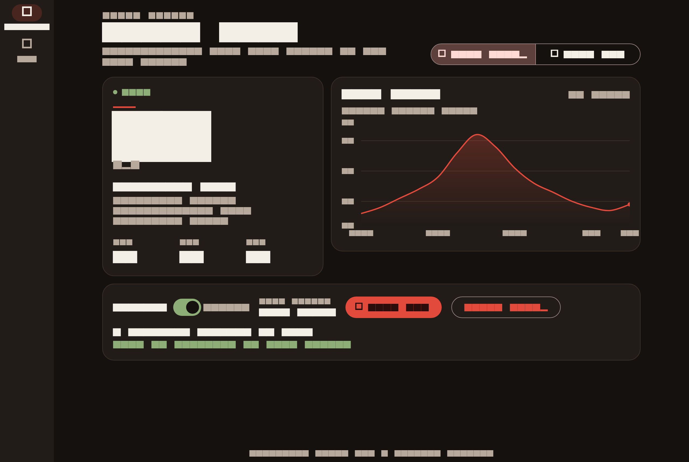
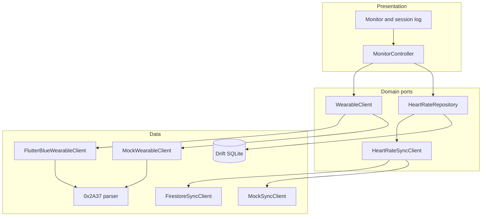
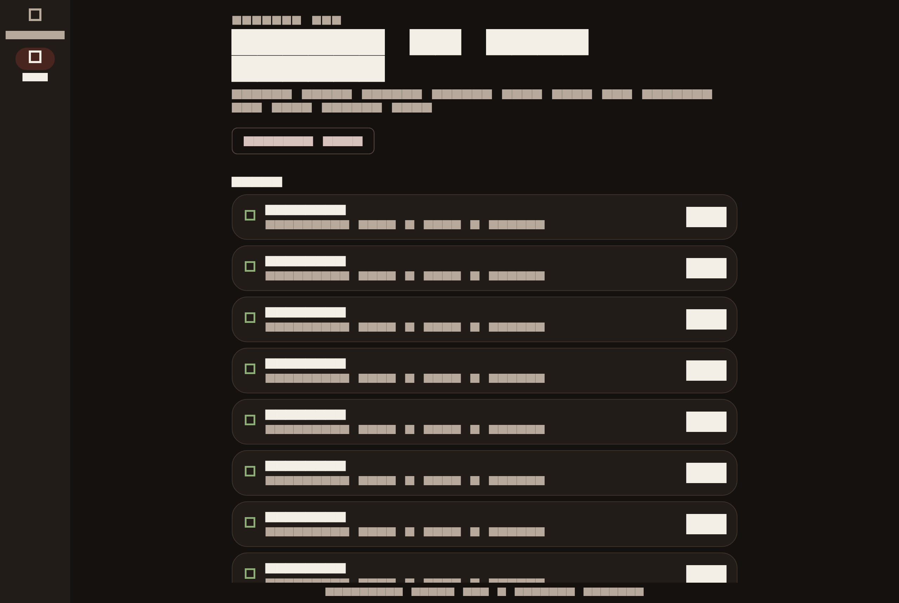
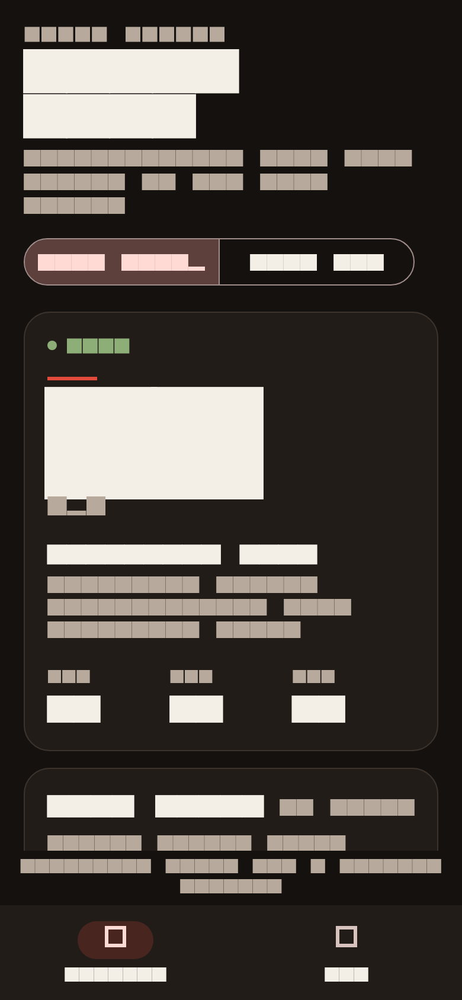

# Pulse Ledger

Portfolio demo by [Arpan Bom](https://github.com/applycoding). Pulse Ledger is a small Flutter app that reads a BLE heart-rate wearable, draws a live BPM trace, stores every beat on the device, and syncs the queue when a network is available.

This is a **demo / portfolio project**, not a medical device. It is not clinically validated, and it must not be used for diagnosis or treatment.

The default run does not need a wearable, a Firebase project, or a `google-services` file. A simulated strap and an in-memory sync client exercise the same parser, database, and sync flow as the live path.



## Features

- Live BPM readout, min / average / max, and a trace of the latest stored beats.
- Bluetooth Low Energy client for the standard **Heart Rate Service `0x180D`** and **Heart Rate Measurement characteristic `0x2A37`**, via `flutter_blue_plus`.
- A spec-shaped measurement parser: 8-bit and 16-bit heart rate, sensor-contact flags, optional energy expended, and RR intervals in 1/1024-second units.
- **Demo strap** that emits real `0x2A37` packets through that parser, so the app runs with no radio.
- **Offline-first log** in SQLite through Drift. Readings are stored before any network call. Unsynced rows stay queued.
- **Sync port** with two bindings:
  - `FirestoreSyncClient` writes documents with the Firestore REST API when `FIREBASE_PROJECT_ID` and `FIREBASE_API_KEY` are set.
  - `MockSyncClient` is the default. It keeps uploads in memory so the demo runs without credentials.
- An explicit online/offline switch. It is a demo control for the queue, not a silent probe of the host network.
- Monitor and session log, including a narrow layout.
- Unit tests for the parser, repository, and Firestore payload, plus widget tests for the monitor and log.

## Architecture

Riverpod controllers sit on a small set of ports. Drift is the source of truth. Sync never writes a beat that has not already been stored locally.



| Piece | Role |
| --- | --- |
| `lib/domain` | Readings, stats, and the wearable, repository, and sync ports |
| `lib/data/ble` | `0x2A37` codec, demo waveform, and the `flutter_blue_plus` client |
| `lib/data/local` | Drift database. Generated code is committed |
| `lib/data/remote` | Mock sync and the Firestore REST client |
| `lib/application` | Riverpod graph and the monitor controller |
| `lib/presentation` | Theme, monitor, and session log |

## Tech stack

- Flutter 3.47 / Dart 3.13 (stable channel in CI)
- `flutter_riverpod` for state
- `flutter_blue_plus` for BLE. This personal portfolio demo uses it under the plugin's nonprofit / personal license. Commercial use of that plugin needs its commercial license.
- `drift` and `drift_flutter` for the local log
- `fl_chart` for the trace
- Firestore REST via `package:http`, behind `HeartRateSyncClient`. The native `cloud_firestore` plugin is not linked, so desktop and CI builds do not need Firebase config. A production mobile app can implement the same port with `cloud_firestore`.
- Figtree and Fraunces, both under the SIL Open Font License (`third_party/fonts`)

An API key sent to the Firestore REST API is not authentication. A real project needs security rules, and usually Firebase Auth. The demo does not pretend otherwise.

## How to run

```bash
flutter pub get
flutter run
```

The app starts on the demo strap and the mock cloud. Pause the strap, flip **Network** off, and new beats stay queued. Flip it back on, or press **Sync now**, and the queue flushes.

Live scan (a wearable must advertise Heart Rate Service `0x180D`):

```bash
flutter run --dart-define=DEMO_MODE=false
```

Or switch to **Live BLE** in the app. Android 12+ needs Bluetooth scan and connect permission. The manifest declares them. iOS and macOS need the Bluetooth usage string and, on macOS, the Bluetooth sandbox entitlement. Those are already in the project. Linux live scan needs BlueZ; if the adapter is missing, the screen says so and demo mode still works.

Firestore, still optional:

```bash
flutter run \
  --dart-define=FIREBASE_PROJECT_ID=your-project \
  --dart-define=FIREBASE_API_KEY=your-web-api-key
```

Documents are written to `heartRateReadings`. Rules must allow that create. Without both defines, sync stays on the mock client.

If you change the Drift schema:

```bash
dart run build_runner build --delete-conflicting-outputs
```

## Tests

```bash
flutter test
```

GitHub Actions (`.github/workflows/ci.yml`) runs `flutter analyze`, checks that the committed Drift code matches `build_runner`, and runs `flutter test` on the stable channel.

Screenshots in `docs/screenshots/` are rendered from the demo harness (`tool/capture_screenshots.dart`). They are not photos of a physical device.

## Screenshots

**Monitor, demo strap, mock cloud**


**Session log**



**Narrow layout**



## License

[MIT](LICENSE). Copyright 2026 Arpan Bom.
